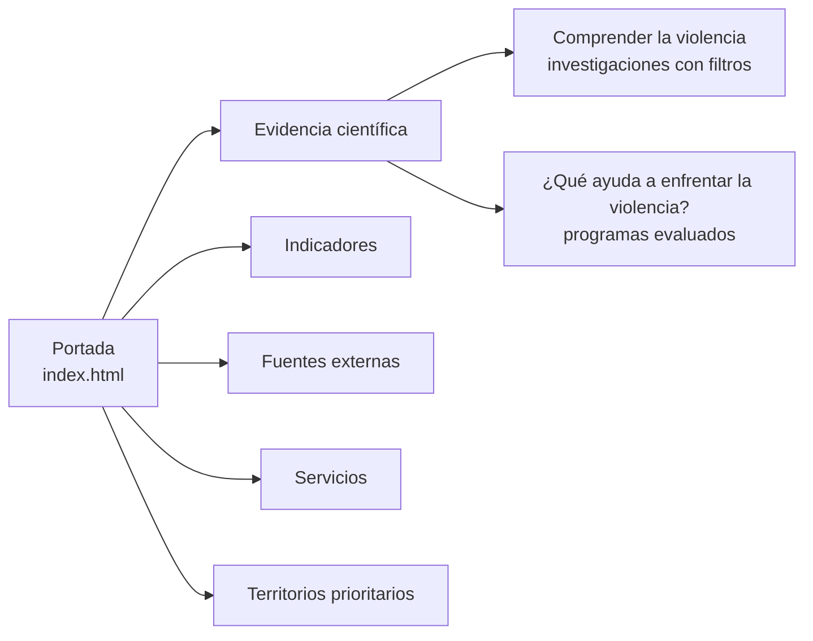
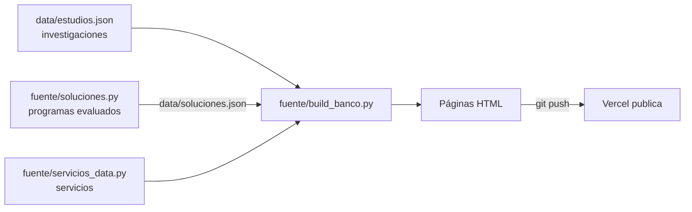

<div align="center">


# Banco de Evidencias

**Observatorio Nacional de la Violencia contra las Mujeres y los Integrantes del Grupo Familiar · MIMP**

Evidencia científica, servicios, indicadores y fuentes de datos oficiales sobre la violencia contra las mujeres y los integrantes del grupo familiar, en el marco de la Ley N.° 30364.

[](https://banco-evidencias-mimp.vercel.app/)
[](https://banco-evidencias-mimp.vercel.app/evidencia.html)
[](https://www.gob.pe/74905-ley-n-30364-ley-para-prevenir-sancionar-y-erradicar-la-violencia-contra-las-mujeres-y-los-integrantes-del-grupo-familiar)

</div>

---

## Contenido

- [Qué es](#qué-es)
- [Las cinco secciones](#las-cinco-secciones)
- [Cómo se ordena la evidencia](#cómo-se-ordena-la-evidencia)
- [Servicios del MIMP](#servicios-del-mimp)
- [Territorios prioritarios](#territorios-prioritarios)
- [Actualizar el sitio](#actualizar-el-sitio)
- [Estructura del repositorio](#estructura-del-repositorio)
- [Preguntas frecuentes](#preguntas-frecuentes)
- [Marco normativo y créditos](#marco-normativo-y-créditos)

---

## Qué es

El artículo 43 de la **Ley N.° 30364** encarga al Observatorio Nacional desarrollar «un sistema de información permanente que brinde insumos para el diseño, implementación y gestión de políticas públicas». Este banco reúne esos insumos en un solo sitio, organizados con las categorías de la propia Ley.

Es un sitio **estático** (HTML, CSS y archivos JSON) publicado en Vercel. No necesita servidor ni base de datos.

---

## Las cinco secciones

| Sección | Qué contiene |
|---|---|
| **[Evidencia científica](https://banco-evidencias-mimp.vercel.app/evidencia.html)** | 120 investigaciones sobre la violencia que comprende la Ley N.° 30364 y 11 programas evaluados |
| **[Indicadores](https://banco-evidencias-mimp.vercel.app/tablero.html)** | Tablero de Power BI con las cifras principales del Observatorio |
| **[Fuentes externas](https://banco-evidencias-mimp.vercel.app/fuentes.html)** | ENDES, ENARES, Warmi Ñan, Ministerio Público, Poder Judicial y MIMP |
| **[Servicios](https://banco-evidencias-mimp.vercel.app/servicios.html)** | Los servicios del Catálogo de Servicios del Sector 2026, en tres niveles y en lenguaje sencillo |
| **[Territorios prioritarios](https://banco-evidencias-mimp.vercel.app/territorios-prioritarios.html)** | Tablero por provincia con los casos atendidos por los CEM en 2025 |



---

## Cómo se ordena la evidencia

La evidencia científica tiene dos puertas.

### Comprender la violencia

Todas las investigaciones en una lista, con filtros. Solo se incluyen estudios sobre la violencia que comprende la Ley N.° 30364.

| Filtro | Opciones | Base en la Ley N.° 30364 |
|---|---|---|
| Tema de investigación | Causas y consecuencias de la violencia · Prevención · Atención y recuperación de las víctimas · Protección de las víctimas · Persecución y sanción · Reeducación de las personas agresoras · Reparación del daño | Art. 1 (y arts. 42 y 45 para causas y consecuencias) |
| Tipo de violencia | Física · Psicológica · Sexual · Económica o patrimonial | Art. 8 |
| Modalidad | Pareja, feminicidio, trata, tecnologías, conflicto armado, entre otras | Reglamento (por verificar) |
| Población | Mujeres · Integrantes del grupo familiar · Niñas, niños y adolescentes · Personas adultas mayores · Personas con discapacidad · Varones y personas agresoras · Operadores del sistema | Arts. 1 y 7 |
| Ámbito | Nacional o internacional | — |

Cada investigación tiene un resumen en lenguaje sencillo, una ficha completa y el enlace a la fuente.

### ¿Qué ayuda a enfrentar la violencia?

Programas evaluados, ordenados por eje de la Ley: prevención (art. 27), atención y recuperación (arts. 27 al 29), protección y sanción (arts. 13 al 26) y reeducación de personas agresoras (arts. 30 al 32). Cada programa resume lo que encontraron sus evaluaciones y enlaza a los estudios. Una evaluación no implica que el programa sea efectivo.

---

## Servicios del MIMP

La sección presenta los servicios del [Catálogo de Servicios del Sector Mujer y Poblaciones Vulnerables 2026](https://cdn.www.gob.pe/uploads/document/file/9387740/7693547-catalogo-de-servicios-del-sector-mujer-y-poblaciones-vulnerables.pdf) en tres niveles:

1. **Servicios que llegan directamente a las personas:** prevención, protección, atención y orientación, asistencia económica y promoción.
2. **Autorizaciones y acreditaciones.**
3. **Apoyo a otras entidades:** capacitación, información especializada, supervisión y sanción.

Los servicios aparecen al elegir un tipo. Por defecto se muestran los vinculados con la Ley N.° 30364; al desmarcar el filtro se ve el catálogo completo. Las descripciones están en `fuente/servicios_data.py`.

---

## Territorios prioritarios

Tablero con los casos atendidos por los Centros Emergencia Mujer y Familia en 2025, por provincia: filtros por periodo y departamento, tarjetas por tipo de violencia, distribución por sexo y grupo etario, mapa por nivel de prioridad y ranking de provincias. Solo contiene datos agregados; las cifras menores a 5 se muestran como «menos de 5». Los registros administrativos muestran casos atendidos, no la prevalencia de la violencia.

---

## Actualizar el sitio



- **Agregar o corregir una investigación:** edita `data/estudios.json`. Es la base publicada. Cada estudio necesita al menos `n`, `t` (título), `tipos`, `temas`, `pob_g`, `amb`, `link` y, de preferencia, `resumen`.
- **Agregar o cambiar un programa evaluado:** edita `fuente/soluciones.py` y corre `python3 fuente/soluciones.py`.
- **Cambiar textos, servicios o diseño de las páginas:** edita `fuente/build_banco.py` o `fuente/servicios_data.py` y corre `python3 fuente/build_banco.py`.
- **Publicar:** `git push`. Vercel publica en uno o dos minutos.

> Importante: las páginas se generan con `fuente/build_banco.py`. Si se edita un HTML a mano, ese cambio debe copiarse también en el generador, o se perderá en la siguiente actualización.

`fuente/export_estudios.py` se mantiene como referencia: reconstruye la lista inicial desde la matriz original en `fuente/estudios_desde_matriz.json` y no modifica la base publicada.

Para probar en tu computadora:

```bash
python3 -m http.server 8000
# abre http://localhost:8000
```

---

## Estructura del repositorio

```text
├── index.html                      Portada con las cinco secciones
├── evidencia.html                  Evidencia científica: dos puertas, filtros y fichas
├── servicios.html                  Servicios del MIMP en tres niveles
├── tablero.html                    Indicadores (Power BI incrustado)
├── fuentes.html                    Fuentes externas de datos
├── territorios-prioritarios.html   Tablero de territorios prioritarios (CEM 2025)
├── banco.css                       Estilos compartidos
├── data/estudios.json              Investigaciones publicadas
├── data/soluciones.json            Programas evaluados
├── matriz/                         Matriz de evidencias completa en Excel
├── img/                            Logos
└── fuente/
    ├── build_banco.py              Genera las páginas
    ├── soluciones.py               Programas evaluados → data/soluciones.json
    ├── servicios_data.py           Servicios del Catálogo 2026
    ├── export_estudios.py          Referencia: lista inicial desde la matriz
    ├── nuevos.py, resumenes.py     Estudios agregados y resúmenes de la primera versión
    └── matriz.csv, data.json       Matriz original y datos intermedios
```

---

## Preguntas frecuentes

<details>
<summary><b>¿Por qué solo estudios sobre violencia?</b></summary>

Porque el banco se organiza en el marco de la Ley N.° 30364. Los estudios sobre igualdad de oportunidades y cuidados que no tratan un tipo de violencia siguen en la matriz completa en Excel, pero no forman parte del banco.

</details>

<details>
<summary><b>¿De dónde salen los temas y las poblaciones?</b></summary>

Los temas siguen las acciones del artículo 1 de la Ley (prevenir, atender, proteger, sancionar, reeducar y reparar) y los artículos 42 y 45 (causas y consecuencias). Las poblaciones son los sujetos de protección de los artículos 1 y 7. La clasificación de cada estudio es orientativa y está por validar.

</details>

<details>
<summary><b>¿Por qué «igualdad de oportunidades» y no «género»?</b></summary>

Para alinearse con la Ley N.° 32535, Ley de igualdad de oportunidades entre mujeres y hombres.

</details>

---

## Marco normativo y créditos

- [Ley N.° 30364](https://www.gob.pe/74905-ley-n-30364-ley-para-prevenir-sancionar-y-erradicar-la-violencia-contra-las-mujeres-y-los-integrantes-del-grupo-familiar): Ley para prevenir, sancionar y erradicar la violencia contra las mujeres y los integrantes del grupo familiar.
- [R.M. N.° 027-2025-MIMP](https://cdn.www.gob.pe/uploads/document/file/7588151/6439639-anexo-rm-n-027-2025-mimp.pdf?v=1738852952): Lineamientos para el funcionamiento del Observatorio Nacional.
- [Catálogo de Servicios del Sector Mujer y Poblaciones Vulnerables 2026](https://cdn.www.gob.pe/uploads/document/file/9387740/7693547-catalogo-de-servicios-del-sector-mujer-y-poblaciones-vulnerables.pdf).

**Elabora:** Observatorio Nacional de la Violencia contra las Mujeres y los Integrantes del Grupo Familiar, Ministerio de la Mujer y Poblaciones Vulnerables (MIMP).
**Contacto:** observatorioviolencia@mimp.gob.pe · (01) 626-1600, anexo 8503
