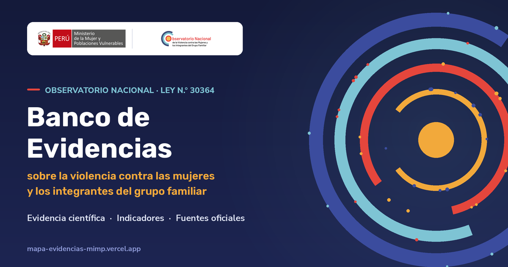
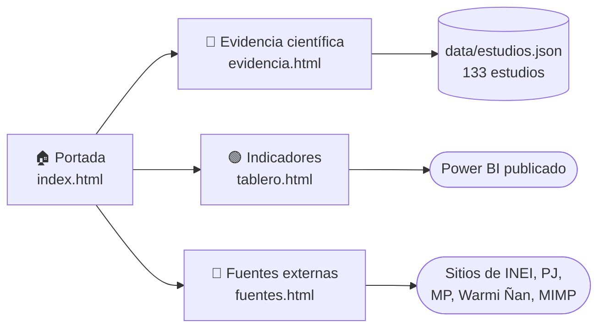
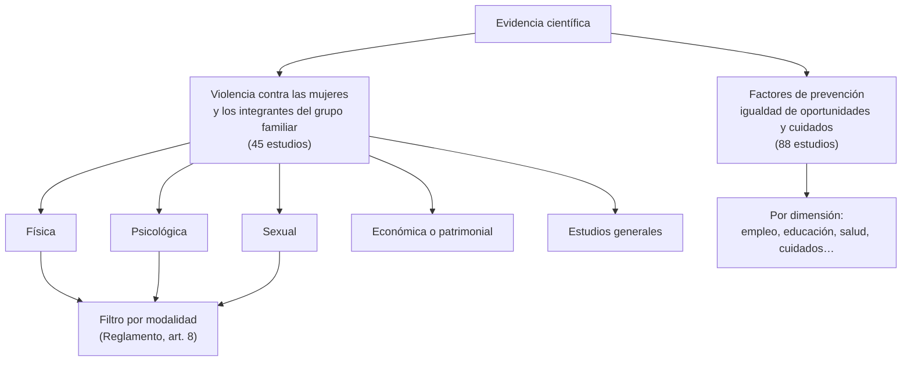
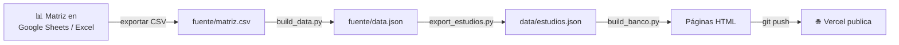

<div align="center">



# Banco de Evidencias

**Observatorio Nacional de la Violencia contra las Mujeres y los Integrantes del Grupo Familiar · MIMP**

Evidencia científica, indicadores y fuentes de datos oficiales sobre la violencia contra las mujeres y los integrantes del grupo familiar, en el marco de la Ley N.° 30364.

[](https://mapa-evidencias-mimp.vercel.app/)
[](https://mapa-evidencias-mimp.vercel.app/evidencia.html)
[](https://www.gob.pe/74905-ley-n-30364-ley-para-prevenir-sancionar-y-erradicar-la-violencia-contra-las-mujeres-y-los-integrantes-del-grupo-familiar)

[](https://vercel.com/new/clone?repository-url=https%3A%2F%2Fgithub.com%2Faotero1703%2Fmapa-evidencias-mimp&project-name=banco-de-evidencias)

</div>

---

## Contenido

- [Qué es](#qué-es)
- [Las tres secciones](#las-tres-secciones)
- [Cómo se ordena la evidencia](#cómo-se-ordena-la-evidencia)
- [Replicarlo en 5 pasos](#replicarlo-en-5-pasos)
- [Actualizar los estudios](#actualizar-los-estudios)
- [Estructura del repositorio](#estructura-del-repositorio)
- [Preguntas frecuentes](#preguntas-frecuentes)
- [Marco normativo y créditos](#marco-normativo-y-créditos)

---

## Qué es

El artículo 43 de la **Ley N.° 30364** encarga al Observatorio Nacional desarrollar «un sistema de información permanente que brinde insumos para el diseño, implementación y gestión de políticas públicas». Este banco reúne en un solo sitio tres tipos de insumos:

| | Sección | Qué contiene | Base legal |
|---|---|---|---|
| 🔵 | **[Evidencia científica](https://mapa-evidencias-mimp.vercel.app/evidencia.html)** | 133 estudios nacionales e internacionales, con ficha y enlace al estudio original | Ley 30364, art. 43: elaborar informes, estudios y propuestas |
| 🟢 | **[Indicadores principales](https://mapa-evidencias-mimp.vercel.app/tablero.html)** | Tablero de Power BI con las cifras clave | Ley 30364, art. 43: monitorear, recolectar, producir y sistematizar datos |
| 🔴 | **[Fuentes externas](https://mapa-evidencias-mimp.vercel.app/fuentes.html)** | Enlaces a ENDES, ENARES, Warmi Ñan, Ministerio Público, Poder Judicial y MIMP | R.M. N.° 027-2025-MIMP: articular la información del Sistema Nacional |

Es un sitio **estático**: HTML, CSS y un archivo JSON con los estudios. No necesita servidor ni base de datos, salvo para el contador de visitas, que es opcional.

---

## Las tres secciones



---

## Cómo se ordena la evidencia

La página de evidencia científica no muestra todo de golpe: primero se eligen los **estantes**, y recién después se ven los estudios.



- **Tipos de violencia:** los cuatro del artículo 8 de la Ley N.° 30364. Un estudio puede estar en más de uno.
- **Modalidades:** las del artículo 8 del Reglamento, por ejemplo violencia en relación de pareja, feminicidio, trata con fines de explotación sexual o violencia a través de las tecnologías de la información.
- **Ámbito:** nacional (Perú) o internacional.

<details>
<summary><b>Ver los códigos de tipo y modalidad</b></summary>

La matriz original no tenía estas columnas, así que se asignaron a partir del título y las variables de cada estudio. Están en `fuente/export_estudios.py`, en los diccionarios `TIPO` y `MOD`, y **deben validarse**.

| Código | Tipo de violencia |
|---|---|
| `F` | Violencia física |
| `P` | Violencia psicológica |
| `S` | Violencia sexual |
| `E` | Violencia económica o patrimonial |
| `G` | Estudio general (varios tipos o sin tipo específico) |

Ejemplo: `TIPO = {74: 'FPS', ...}` significa que el estudio n.° 74 aborda violencia física, psicológica y sexual.

</details>

---

## Replicarlo en 5 pasos

¿Quieres un banco igual para tu observatorio regional u otra institución? Marca cada paso a medida que avanzas:

- [ ] **1. Copia el repositorio.** Usa el botón **Fork** de GitHub o el botón **Deploy with Vercel** de arriba, que copia y publica en un solo paso.
- [ ] **2. Prepara tu matriz.** Usa las mismas columnas que [`fuente/matriz.csv`](fuente/matriz.csv), expórtala como CSV y reemplaza ese archivo.
- [ ] **3. Genera los datos y las páginas** (necesitas Python 3):
  ```bash
  python3 fuente/build_data.py fuente/matriz.csv   # limpia la matriz → fuente/data.json
  python3 fuente/export_estudios.py                # tipos, modalidades y ámbito → data/estudios.json
  python3 fuente/build_banco.py                    # portada, evidencia, tablero y fuentes
  ```
- [ ] **4. Personaliza.**
  - **Logos:** en `img/`.
  - **Colores:** en `banco.css`, dentro de `:root`.
  - **Enlace del tablero:** la variable `POWERBI` en `fuente/build_banco.py`.
  - **Lista de fuentes externas:** la variable `SRC` en `fuente/build_banco.py`.
- [ ] **5. Publica.** Sube los cambios con `git push`. Si conectaste el repositorio a [Vercel](https://vercel.com), se publica solo en uno o dos minutos.

<details>
<summary><b>Columnas que debe tener la matriz</b></summary>

`N°`, `Temática`, `Dimensiones`, `Nivel de evidencia`, `Título`, `Autor`, `Año`, `País`, `Población objetivo de la evidencia encontrada`, `Propósito del estudio`, `Tipo de intervención`, `Detalles de la intervención`, `Diseño de aleatorización`, `Estado de la evaluación de impacto`, `Variable(s) Y`, `Variable(s) X`, `Resultados`, `Vínculo`, `Lugar de publicación`.

- **Nivel de evidencia** usa códigos como `A.1 Meta análisis`, `B.3 …` o `C.1 Estudios de factores asociados`.
- **País:** si es Perú, el estudio cuenta como nacional; cualquier otro país, como internacional.

</details>

<details>
<summary><b>Probarlo en tu computadora antes de publicar</b></summary>

```bash
python3 -m http.server 8000
# abre http://localhost:8000 en el navegador
```

La página de evidencia carga `data/estudios.json`, así que necesita un servidor local. Si abres el archivo con doble clic, no carga los estudios.

</details>

---

## Actualizar los estudios



Para agregar un estudio nuevo:

1. Agrégalo a la matriz con un `N°` nuevo.
2. En `fuente/export_estudios.py`, asígnale su tipo (`TIPO`) y su modalidad (`MOD`), si es un estudio de violencia.
3. Corre los tres scripts y haz `git push`.

---

## Estructura del repositorio

```text
├── index.html              Portada con las tres secciones
├── evidencia.html          Evidencia científica (estantes, buscador y fichas)
├── tablero.html            Tablero de indicadores (Power BI incrustado)
├── fuentes.html            Fuentes externas de datos
├── mapa.html               Versión anterior: mapa de brechas (se mantiene por enlaces antiguos)
├── banco.css               Estilos compartidos
├── data/estudios.json      Los estudios que lee evidencia.html
├── matriz/                 Matriz revisada en Excel (descargable desde el sitio)
├── img/                    Logos
├── og-banco.png            Imagen que aparece al compartir el enlace
├── api/visitas.js          Contador de visitas (función de Vercel, opcional)
├── vercel.json             Configuración de Vercel
└── fuente/
    ├── matriz.csv          Matriz original exportada
    ├── build_data.py       Paso 1: limpia la matriz
    ├── export_estudios.py  Paso 2: tipos, modalidades y ámbito
    ├── build_banco.py      Paso 3: genera las páginas
    ├── data.json           Datos intermedios
    └── template.html       Plantilla del mapa de brechas (versión anterior)
```

---

## Preguntas frecuentes

<details>
<summary><b>¿Cómo activo el contador de visitas?</b></summary>

1. En Vercel, entra al proyecto y luego a **Storage → Create Database → Upstash for Redis**.
2. Conéctala al proyecto. Vercel crea solas las variables `KV_REST_API_URL` y `KV_REST_API_TOKEN`.
3. Vuelve a publicar. El pie de página mostrará «N visitas al banco de evidencias».

Mientras no haya base conectada, el contador simplemente no aparece.

</details>

<details>
<summary><b>¿Puedo usar otro tablero en lugar de Power BI?</b></summary>

Sí. Cambia la variable `POWERBI` en `fuente/build_banco.py` por el enlace público de tu tablero (Power BI «Publicar en la web», Tableau Public, Looker Studio, etc.) y vuelve a correr el script.

</details>

<details>
<summary><b>¿Por qué los estudios se ordenan por tipo y modalidad de violencia?</b></summary>

Porque son las categorías de la propia Ley N.° 30364 y su Reglamento. Así, cualquier persona del Sistema Nacional (CEM, fiscalías, juzgados, gobiernos regionales) encuentra la evidencia con los mismos términos que usa en su trabajo.

</details>

<details>
<summary><b>¿Por qué «igualdad de oportunidades» y no «género»?</b></summary>

Para alinearse con la Ley N.° 32535, Ley de igualdad de oportunidades entre mujeres y hombres (2025), que reemplazó a la Ley N.° 28983.

</details>

<details>
<summary><b>Encontré un error en un estudio, ¿cómo lo corrijo?</b></summary>

Corrígelo en la matriz y sigue los pasos de [Actualizar los estudios](#actualizar-los-estudios). Si solo cambia el tipo o la modalidad, edita `fuente/export_estudios.py` y corre los pasos 2 y 3.

</details>

---

## Marco normativo y créditos

- 📜 [Ley N.° 30364](https://www.gob.pe/74905-ley-n-30364-ley-para-prevenir-sancionar-y-erradicar-la-violencia-contra-las-mujeres-y-los-integrantes-del-grupo-familiar): Ley para prevenir, sancionar y erradicar la violencia contra las mujeres y los integrantes del grupo familiar.
- 📘 [R.M. N.° 027-2025-MIMP](https://cdn.www.gob.pe/uploads/document/file/7588151/6439639-anexo-rm-n-027-2025-mimp.pdf?v=1738852952): Lineamientos para el funcionamiento del Observatorio Nacional.
- 🤝 [Sistema Nacional](https://www.gob.pe/54353-sistema-nacional) para la Prevención, Sanción y Erradicación de la Violencia contra las Mujeres y los Integrantes del Grupo Familiar.

**Elabora:** Observatorio Nacional de la Violencia contra las Mujeres y los Integrantes del Grupo Familiar, Ministerio de la Mujer y Poblaciones Vulnerables (MIMP).
**Contacto:** observatorioviolencia@mimp.gob.pe · (01) 626-1600, anexo 8503
